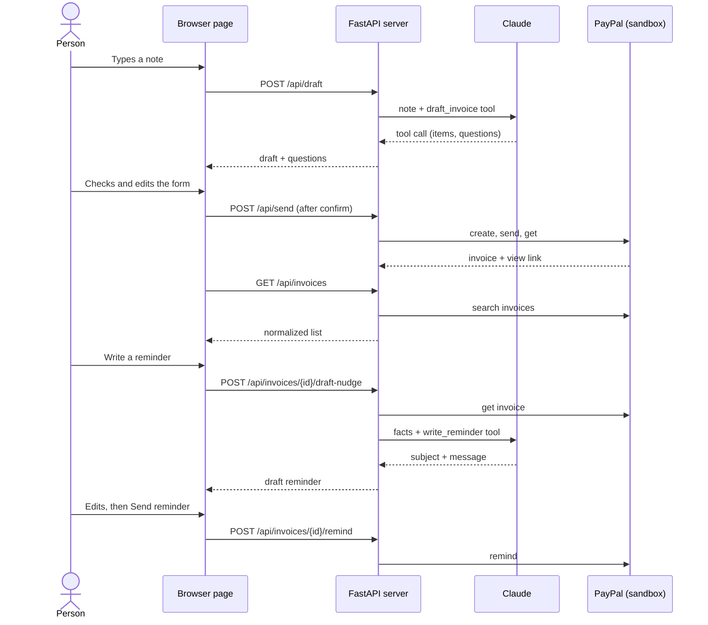

# Architecture

Invoice Autopilot is a small local web app: a FastAPI server (`app/`) and one HTML page (`static/index.html`). It calls Claude to read notes and write reminders, and PayPal Invoicing v2 to create and send invoices.

## Endpoints

| Endpoint | PayPal calls | Claude |
|---|---|---|
| `GET /api/health` | none | none |
| `POST /api/setup` | one token request (checks the PayPal keys) | one tiny request (checks the key) |
| `POST /api/draft` | none | `draft_invoice` tool: note in, structured invoice and questions out |
| `POST /api/send` | create, send, get (deletes the draft if send fails) | none |
| `GET /api/invoices` | search invoices | none |
| `POST /api/invoices/{id}/draft-nudge` | get invoice | `write_reminder` tool: invoice facts and tone in, subject and message out |
| `POST /api/invoices/{id}/remind` | get invoice, remind | none |

The note text is wrapped as data and the prompts tell Claude to ignore instructions inside it. The tool schema is enforced by the prompt, because the current model does not accept a forced `tool_choice`. If Claude does not return a tool call, `/api/draft` returns a friendly error and the reminder falls back to a plain built-in template.

## A person approves everything

- `/api/draft` and `/api/invoices/{id}/draft-nudge` only produce text. They never contact the client.
- The page shows an editable form and a confirm step before `/api/send`. It always sends the values currently in the form.
- A reminder is shown in an editable box and only goes out when the person clicks Send reminder.
- A repeated send with the same request id returns the first result instead of creating a second invoice.
- There are no background jobs and no automatic reminders.

## Security notes

- The server binds to `127.0.0.1` only. It has **no authentication**, so do not expose it to a network and do not add `--host 0.0.0.0`.
- Keys live only in `.env` (file mode 0600, ignored by git). The server never returns them.
- `/api/setup` refuses requests that do not come from localhost (client address, Host header and Origin are all checked).
- All errors shown to the person are plain messages. Technical detail goes to the server log only.
- Sandbox is the default. Live mode needs an explicit `PAYPAL_BASE`.

## Known limits

- The list shows the 25 most recent invoices.
- One currency per invoice.
- No tax, discount or tip fields yet. The AI mentions them as a question instead.
- No automatic reminders. Every reminder is sent by a person.
- Links to view an invoice appear right after sending; older invoices in the list have no link.
