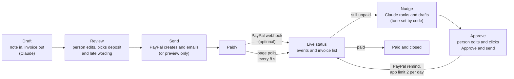
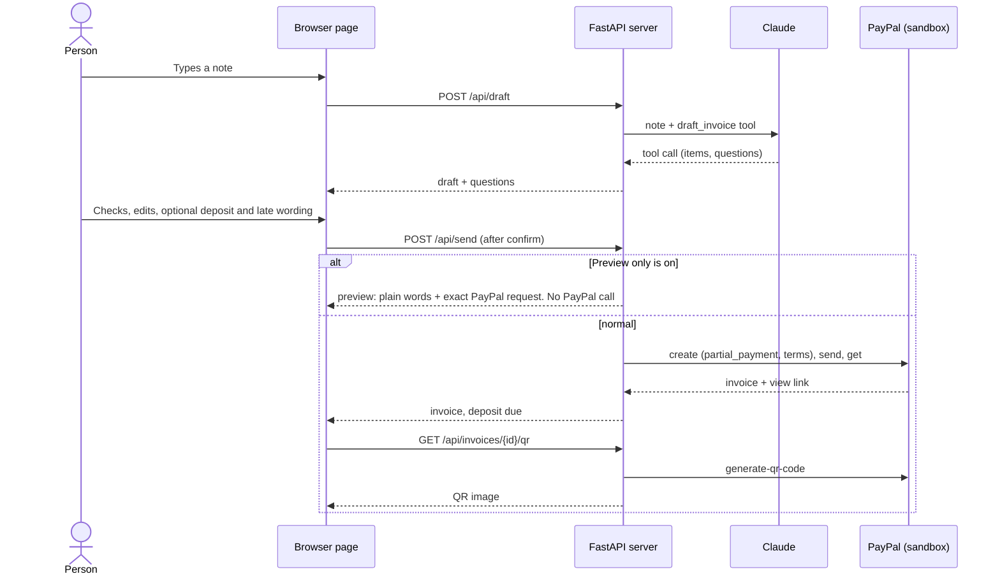
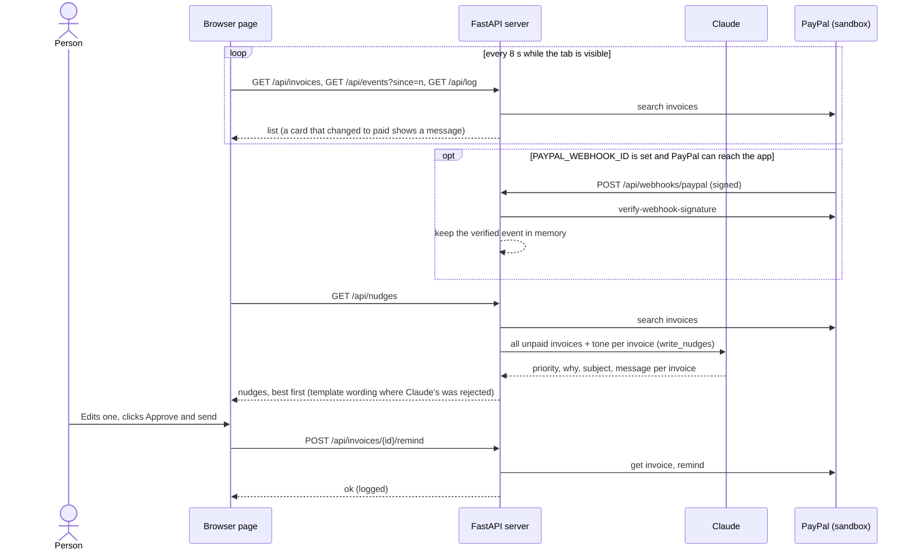

# Architecture

Invoice Autopilot is a small local web app: a FastAPI server (`app/`) and one HTML page (`static/index.html`, plain JavaScript, no build step). Claude reads notes and writes reminders. PayPal Invoicing v2 creates, sends, lists, reminds and takes payments. The app keeps no database: PayPal is the source of truth, and the little it remembers lives in memory (`app/live.py`).

## The loop

Nothing leaves the app without a click: the only arrows into PayPal that write are *Send* (after a confirm) and *Approve* (after the person has seen and maybe edited the text).

## Draft, review, send

## Live status, nudge, approve

## Endpoints

All `/api` routes answer only to pages served from this computer (Host and Origin must be `localhost`, `127.0.0.1` or `::1`), except the webhook. Every error is `{"message": "..."}` in plain English.

| Endpoint | PayPal calls | Claude |
|---|---|---|
| `GET /api/health` | none | none. Also reports `sandbox`, `safe_mode`, `webhooks_ready` |
| `POST /api/setup` | one token request (checks the PayPal keys). Localhost only | one tiny request (checks the key) |
| `POST /api/safe-mode` `{enabled}` | none. Localhost only. In memory | none |
| `POST /api/draft` | none | `draft_invoice`: note in, structured invoice and questions out |
| `POST /api/send` | create, send, get (deletes the draft if send fails). Optional `deposit_percent` (10 to 90) and `late_fee_note` | none |
| `GET /api/invoices` | search invoices | none |
| `GET /api/invoices/{id}/qr` | generate-qr-code | none |
| `POST /api/invoices/{id}/record-test-payment` | get, payments (method `CASH`), get. Sandbox only. In Preview only: get, and the payload comes back unsent | none |
| `POST /api/invoices/{id}/draft-nudge` | get invoice | `write_reminder`: facts and tone in, subject and message out |
| `GET /api/nudges[?refresh=true]` | search invoices | `write_nudges`: one call for all unpaid invoices, priority, why, subject, message |
| `POST /api/invoices/{id}/remind` | get invoice, remind | none |
| `POST /api/demo/seed` | create, send, get, once. Sandbox only | none |
| `GET /api/log` | none | none |
| `GET /api/events?since=n` | none | none |
| `POST /api/webhooks/paypal` | verify-webhook-signature | none |

An invoice id must match `^[A-Za-z0-9_-]{1,64}$` before it is put into a PayPal address.

### Preview only (safe mode)

When it is on, `/api/send`, `/api/demo/seed`, `/api/invoices/{id}/remind` and `/api/invoices/{id}/record-test-payment` return `{"preview": true, "message": ..., "payload": ...}` instead of acting. `send` makes no PayPal call at all. `remind` and `record-test-payment` make one read (to name the client and check the invoice can be reminded or paid, with the same plain refusals as the real thing), never a write. The page treats `preview: true` as "nothing happened": it shows the message, does not move on to the sent screen (or patch the card to Paid), and the log stays empty. QR codes are not blocked, because generating one creates nothing. `record-test-payment` still refuses outside PayPal's sandbox before it even previews.

### Nudges in detail

1. `paypal.awaiting_payment` keeps invoices that can be reminded and still have something owed (not paid, cancelled, draft, payment pending, or zero), most overdue first.
2. `ai.nudge_tone` picks the tone from the days late: 0 or not yet due friendly, 1 to 7 polite, 8 to 21 firm, more than 21 final. It is passed to Claude. The tool schema has no tone field, so Claude cannot change it.
3. One Claude call (`write_nudges`) gets every invoice as data and returns a priority, a short reason, a subject and a message for each.
4. `ai.clean_nudge_text` checks each field. It rejects links, emails, placeholders and brackets, late fee, interest, legal or collections wording, calling a not-yet-due invoice late, and over-long text. Numbers are checked by role, not by digit: any money (a currency sign or code, a money word, cents or a thousands comma) must equal the amount still owed exactly (so a partly paid invoice's total is refused, and so is "$1" on invoice 0001); amounts spelled in words ("one dollar") are refused; every date must be the due date and any month name must be its month; a bare number must be the real days late (or to go), a day of the due date, or the invoice number introduced as such ("invoice 0001"). Subjects and messages (what the client reads) are also checked against the tone the code chose: no threats in any tone ("or else", "warning", "consequences"), nothing "final" or pushy in a softer tone, and no "no rush" in a firmer one. The short reason shown to the freelancer gets the number checks but not the tone check. A rejected subject or message falls back to `ai.fallback_reminder` for that invoice, and a rejected reason falls back to a built-in one. Claude's *order* is used as it comes: it is its judgement, and the code only makes it a clean 1 to N. If Claude fails entirely, every invoice falls back and the endpoint still answers 200. The field `drafted_by` says which it was.
5. Priorities are made a clean 1 to N. A clean all-Claude answer is cached for 10 minutes (keyed by the invoice facts). Fallbacks are never cached. `?refresh=true` skips the cache.
6. `already_reminded_today` comes from this app's own log. The page disables **Approve & send** for those, and `/remind` itself refuses a third reminder in a day with a plain message.

### Webhook and events

`POST /api/webhooks/paypal` is the only route exempt from the localhost check, because PayPal calls it from the internet. Instead it is protected by PayPal's own signature check:

- `PAYPAL_WEBHOOK_ID` unset: `503 Webhooks aren't set up`, nothing is parsed or stored.
- Body over 256 KB: `413`, decided before the body is held in memory: a `Content-Length` over the limit is refused without reading anything, and a body with no `Content-Length` (chunked) is read in pieces and dropped as soon as it passes the limit. The `413` carries `Connection: close`.
- Any of the five `PAYPAL-*` headers missing, or the body not a JSON object: `400`. More than 60 checks a minute: `429`.
- The event is sent to `verify-webhook-signature`. Not `SUCCESS` (or PayPal says 400/422): `400`, never stored. PayPal 5xx or network trouble: `503`, so PayPal retries.
- A verified `INVOICING.INVOICE.*` event is kept in a 50-entry in-memory queue (deduplicated on PayPal's event id). `GET /api/events?since=n` returns what is newer. If `since` is ahead of the server (it restarted), everything kept is returned.

The page polls the events and the list together. A paid event is a nudge to refresh and a fallback for the message; the list is what the cards are drawn from.

### How the page keeps what you typed

The invoice list is updated card by card. A card whose data did not change is not touched, and only the top part of a changed card is redrawn, so an open reminder editor (and the cursor in it) survives a refresh. A reminder editor on an invoice that gets paid is kept but cannot be sent. The "Who to chase today" cards merge new answers into the old ones and never replace words the person has already edited. Polling stops while the tab is hidden, slows down after failures, and shows a quiet message instead of a red box when a refresh fails.

## What is kept in memory

`app/live.py`. Lost on restart, never written to disk.

| What | Size | Used for |
|---|---|---|
| Preview-only switch | 1 flag (starts from `SAFE_MODE`) | `/api/safe-mode`, health |
| Send log (invoices and reminders really sent) | last 50 | Activity list, "already reminded today", the 2-a-day check |
| Verified webhook events | last 50 | `/api/events` |
| Webhook check rate limit | 60 a minute | webhook |
| First demo invoice result | 1 | `/api/demo/seed` never makes a second one |
| Nudge answers | up to 8, 10 minutes | `/api/nudges` |
| Send results by request id | last 500 | a double click never sends two invoices |

## A person approves everything

- `/api/draft`, `/api/invoices/{id}/draft-nudge` and `/api/nudges` only produce text. They never contact the client.
- The page shows an editable form and a confirm step before `/api/send`. It always sends the values currently in the form.
- A reminder, from either place, is shown in editable boxes and only goes out on a click.
- A repeated send with the same request id returns the first result instead of creating a second invoice.
- There are no background jobs and no automatic reminders. The page polling and the passive webhook only read.

## Security notes

- The server binds to `127.0.0.1` only. It has **no authentication**, so do not expose it to a network and do not add `--host 0.0.0.0`. If you tunnel it so PayPal can reach the webhook, expose only `/api/webhooks/paypal` if your tunnel lets you. Every other `/api` route checks the Host header and refuses other names.
- Keys live only in `.env` (file mode 0600, ignored by git). The server never returns them.
- `/api/setup` and `/api/safe-mode` also check the client address, so they work only from this computer.
- All errors shown to the person are plain messages. Technical detail goes to the server log only.
- Sandbox is the default. Live mode needs an explicit `PAYPAL_BASE`. Demo and test-payment routes refuse to run against live PayPal.
- Page text from the server is escaped before it is shown, and links open only when they start with `https://`.

## Tests and CI

`uv run --group dev pytest -q` runs offline: `tests/conftest.py` sets dummy keys before the app loads (so a real `.env` is never read) and blocks every network connection. PayPal is replaced by a fake that records its calls. `tests/test_static.py` checks the page: every endpoint it calls exists in `app/main.py`, every element the script looks up is in the HTML, nothing is loaded from the internet, and the script parses. `.github/workflows/test.yml` runs the same command on every push and pull request.

## Known limits

- The list shows the 25 most recent invoices.
- One currency per invoice.
- No tax, discount or tip fields yet. The AI mentions them as a question instead.
- PayPal does not add late fees, so none are charged. The late payment wording is only printed in the terms.
- No recurring invoices.
- The app sends at most 2 reminders per invoice per day. PayPal's documentation says an API caller can send only 2 reminders a day, but its sandbox accepted more in our tests, so this is the app's own limit (it counts only what it sent since it started).
- The webhook needs a public HTTPS address and is tested only against a faked PayPal.
